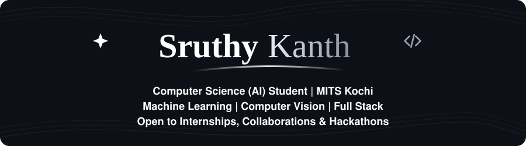
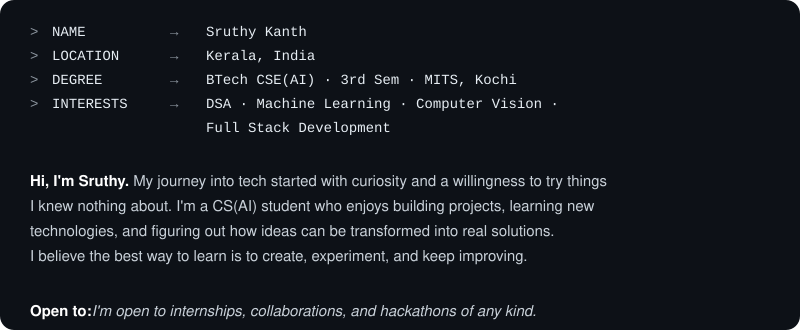
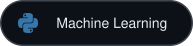
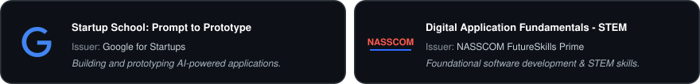
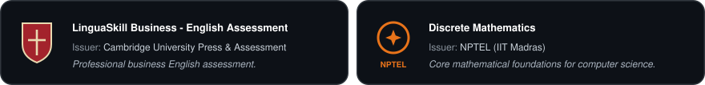
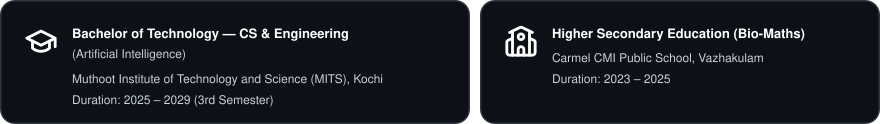

  

&nbsp;
&nbsp;
&nbsp;

   

  

  

  

   

  

**Core Focus Areas**

 

&nbsp;
&nbsp;
&nbsp;

  

**Technical Stack**

 

**Languages**

&nbsp;
&nbsp;
&nbsp;
&nbsp;
&nbsp;

 

**Tools & Environment**

&nbsp;
&nbsp;
&nbsp;

 

**Soft Skills**

&nbsp;•&nbsp;
&nbsp;•&nbsp;
&nbsp;•&nbsp;

   

  

 

   

  

   

  

   

  

Have an opportunity, hackathon invite, or project collaboration in mind? 
**Feel free to reach out!**

 

&nbsp;
&nbsp;
&nbsp;

  

